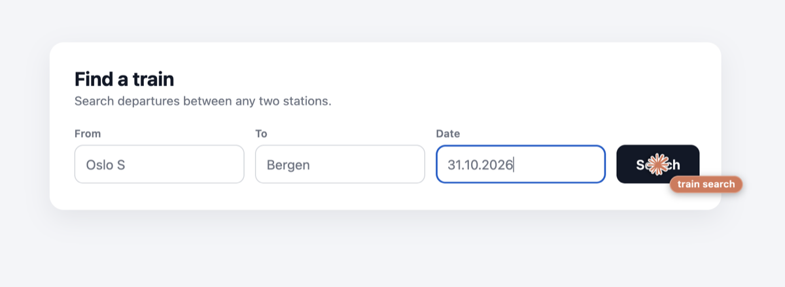
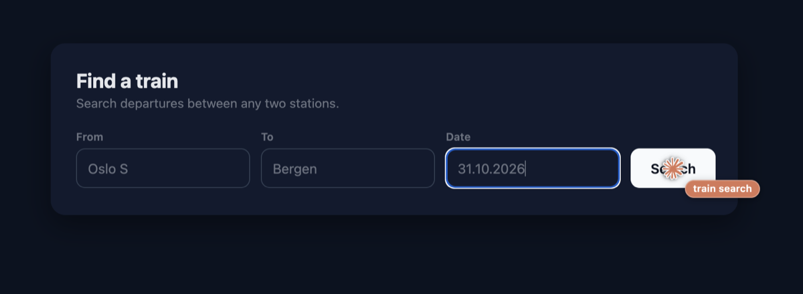

# agent-tabs

**Let several AI agents use your real, logged-in Chrome at the same time, in background tabs, without ever stealing your focus.**

agent-tabs is a Chrome extension plus a small local MCP server that gives agents 27 `browser_*` tools. It has been tested with Claude Code (CLI and subagents). It's a standard Streamable HTTP MCP server, so other MCP clients should work, but they haven't been tried. Each agent works in its own collapsed tab group, sees only its own tabs, and never brings Chrome to the front unless you ask it to.

> **Not affiliated with Anthropic.** This is an independent, unofficial project. For Claude clients the cursor uses the Claude logo; Claude and the Claude logo are trademarks of Anthropic.
>
> **Unmaintained.** This was built for one person's setup and published as is. It works well on macOS with Chrome, but expect no support, releases or fixes. Fork it freely.



## Why

Most browser tools for agents either start a fresh browser with none of your logins, or drive your browser in ways that keep pulling it in front of whatever you're doing. agent-tabs is built for handing everyday admin to agents while you keep working:

- **Your logins.** It's your normal Chrome profile, so agents are already signed in to everything you are.
- **Never steals focus.** Tabs open in the background; popups and `target=_blank` links are rerouted into background tabs; screenshots work on hidden tabs; native file pickers never open.
- **Many agents at once.** One tab group per agent session, strict isolation between them, about 20 ms per action.
- **Signs in for you.** `browser_fill_login` fills username, password and authenticator codes from your Bitwarden vault. The agent never sees the password.
- **Hands steps back to you.** When a site needs a 2-step code, a CAPTCHA or an approval, the agent keeps the tab, asks you, and continues once you're done.
- **Guard rails.** Checkout and payment pages are detected and acting there needs explicit permission; optional site allow and deny lists; no cookie or storage reading; a local action log without page content.
- **A visible cursor.** When you watch an agent's tab, an animated cursor shows what it clicks and types: the Claude mark for Claude clients, a blue arrow for others.



## How it works

```
AI agent ──MCP over HTTP──▶ broker (Node, 127.0.0.1:47615) ──WebSocket + token──▶ Chrome extension ──chrome.debugger (CDP)──▶ agent tabs
```

- The **extension** (Manifest V3) drives tabs through the Chrome DevTools Protocol. It turns on focus emulation on every tab it attaches to, so hidden pages behave as if focused. It injects a small script that turns popups into background tabs, and takes screenshots with CDP rather than `captureVisibleTab`.
- The **broker** is an MCP server. Each MCP session is one agent: its id travels with every operation, so the extension can keep agents apart. Sessions survive broker restarts and extension reloads; a reconnecting client gets its tabs back.
- Tabs close when an agent's process exits, or after 20 minutes idle. A tab handed to you stays open until 30 minutes after its agent ends; tabs an agent kept with `browser_keep_tab` stay until you close them.

## Tools

| | |
|---|---|
| Tabs | `browser_open_tab`, `browser_list_tabs`, `browser_close_tab`, `browser_navigate` (URL, back, forward, reload), `browser_keep_tab`, `browser_show_tab` (the only tool that brings Chrome forward) |
| Reading | `browser_snapshot` (accessibility tree with element refs, including iframes and shadow DOM), `browser_get_text` (paged), `browser_screenshot` (viewport, full page or element), `browser_console`, `browser_downloads` |
| Acting | `browser_click`, `browser_type`, `browser_fill` (a whole form in one call), `browser_select`, `browser_press`, `browser_hover`, `browser_scroll`, `browser_drag`, `browser_upload`, `browser_dialog`, `browser_handle_cookie_banner` |
| Flow | `browser_batch` (up to 30 steps in one call), `browser_wait_for` (text, selector, URL, network idle), `browser_evaluate` |
| People | `browser_fill_login` (Bitwarden), `browser_handoff` (ask the user to do a step) |

## Install (macOS)

Needs Chrome 125+, Node 22+ and macOS (launchd). Other platforms would need their own way to run the broker.

```sh
git clone https://github.com/greendra8/agent-tabs.git && cd agent-tabs
npm ci
npm run setup                   # creates the token and copies it into the extension
./scripts/install-launchd.sh    # runs the broker at login, on 127.0.0.1:47615
```

1. In Chrome, open `chrome://extensions`, turn on **Developer mode**, click **Load unpacked** and pick the `extension/` folder.
2. Check that it's connected: `curl -s http://127.0.0.1:47615/health` should show `"extensionConnected":true`.
3. Add the MCP server to your agent. For Claude Code:

   ```sh
   claude mcp add --transport http agent-tabs http://127.0.0.1:47615/mcp
   ```

   Other clients take the same URL as a Streamable HTTP server: `{"type": "http", "url": "http://127.0.0.1:47615/mcp"}`. Don't put it behind a shared MCP gateway: one upstream session for all agents would merge them into one tab group.

### Optional: Bitwarden sign-in

```sh
brew install bitwarden-cli
# copy your Bitwarden master password, then:
./scripts/bitwarden-unlock.command you@example.com
```

The script logs the CLI in, unlocks the vault, keeps the session key in the macOS keychain and clears your clipboard. Logins are only ever filled into pages that match the login's saved URIs. If the Bitwarden browser extension is also installed in this Chrome, turn it off there: its in-page menu is another extension's frame, and Chrome detaches the debugger from any tab that contains one.

## Tell your agents about it

A line for your `AGENTS.md` or `CLAUDE.md`:

```markdown
- Browser work: use the `agent-tabs` MCP (`browser_*` tools: background tabs in my Chrome with my logins). Sign in with `browser_fill_login`; when a step needs me (2-step code, CAPTCHA, approval), use `browser_handoff` and ask me instead of giving up. Only call `browser_show_tab` if I ask to see a page. Close your tabs when done.
```

The server also sends agents its own usage instructions over MCP: how to work quickly, how to stay safe, and when to hand over.

## Configuration

`~/.config/agent-tabs/config.json` is reloaded automatically; every key is optional:

```json
{
  "deny": ["mybank.example", "*.internal.example.com", "github.com/settings"],
  "allow": [],
  "paymentGuard": true,
  "requireMcpToken": false,
  "idleMinutes": 20,
  "window": "current",
  "cursor": "auto",
  "uploadRoots": ["~", "/tmp"]
}
```

- **`deny` / `allow`:** `example.com` matches the host and its subdomains, `*bank*` is a glob over the host, and `host/path` adds a path prefix. A non-empty `allow` list turns on allow-list mode. Nothing is blocked by default.
- **`paymentGuard`:** on pages with card fields, a payment provider's frame, or two of (checkout-style URL, pay button, payment-method choices), agents may read and navigate, but acting needs `allowPayment: true`. The tools tell agents to pass that only when you explicitly asked for the purchase.
- **`requireMcpToken`:** MCP clients must send `Authorization: Bearer <token>` (the token is in `~/.config/agent-tabs/token`).
- **`window`:** `"dedicated"` puts all agent tabs in one separate window instead of your current one.
- **`cursor`:** `"auto"` shows the Claude mark for clients whose MCP `clientInfo.name` contains "claude" (Claude Code, Claude Desktop) and a neutral blue arrow for everything else; `"claude"` or `"neutral"` forces one for all clients.

## Security model

Read this before installing. The extension has `debugger` and `<all_urls>` permissions in your real profile, so whatever drives it can do anything you can do in that browser.

- The broker listens on 127.0.0.1 only. It rejects requests whose `Host` isn't local and any request carrying an `Origin` header, which blocks web pages and DNS rebinding.
- The extension's connection must come from its own extension origin and present a per-install token.
- `/mcp` is open to local processes unless you set `requireMcpToken`. Any process running as your user could already control Chrome in other ways; the token narrows it to processes that can read your files.
- Page content is untrusted. The tool instructions say so, but prompt injection from web pages is a real risk with any browsing agent. Use `deny`/`allow`, keep the payment guard on, and don't give agents tasks on sites you wouldn't want them to act on.
- `browser_evaluate` refuses obvious cookie and storage access. This is a guard against mistakes and injection, not a sandbox.
- Every tool call is logged to `~/Library/Logs/agent-tabs/actions.log`: host, first two path segments and arguments, with long values masked. No page content, typed text, query strings or secrets.

## Known limits

- A rerouted popup's `window.open` handle is a stub. Sign-in popups (Google, Apple, Microsoft, GitHub, OAuth paths) are let through as real popups for that reason, and Chrome may come forward while one is open.
- Chrome shows its "started debugging this browser" bar while agent tabs are attached.
- Some sites detect automation. Apple's App Store Connect sign-in, for example, never completes in agent tabs.
- Hidden tabs have throttled timers; agents should use `browser_wait_for` rather than fixed sleeps.
- In-process subagents that share one MCP connection share a tab group. Run them as separate processes for isolation.

## Development

```sh
npm run check                  # syntax check, including the script injected into pages
(cd tests/fixtures && python3 -m http.server 47699 --bind 127.0.0.1) &
npm run test:e2e               # 42 end-to-end checks against the real extension
node tests/long-session.mjs    # survives an extension reload and a broker restart
npm run reload-extension       # reload the extension after editing it
npm run cleanup-tabs           # close agent-group tabs that no live agent owns
```

`tests/focus-log.swift` logs the frontmost app and the topmost window every 100 ms. It's how "never steals focus" was checked.

## Uninstall

1. Run `./scripts/uninstall-launchd.sh`.
2. In `chrome://extensions`, remove Agent Tabs.
3. Remove the MCP server from your clients.
4. Optionally: `rm -rf ~/.config/agent-tabs ~/Library/Logs/agent-tabs ~/Library/Caches/agent-tabs`.
5. If you used Bitwarden: `bw logout` and `security delete-generic-password -a agent-tabs -s agent-tabs-bitwarden`.

## License

MIT. See [LICENSE](LICENSE).
